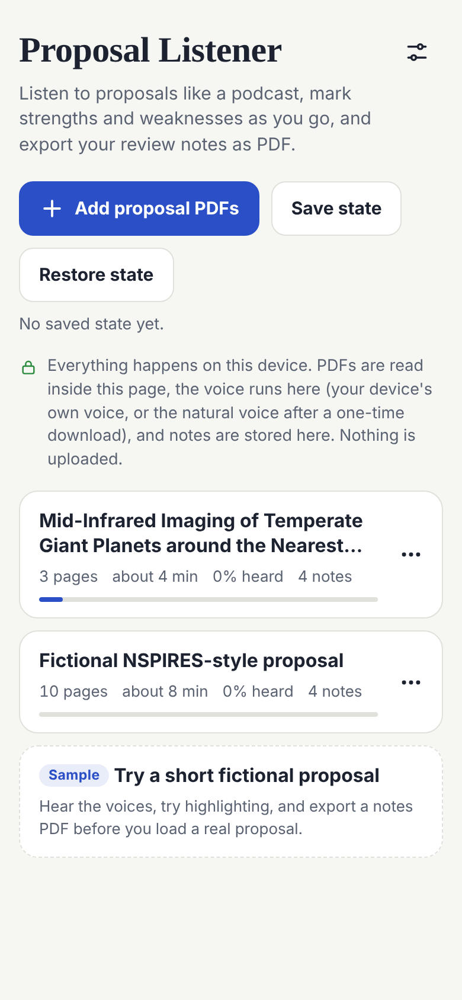
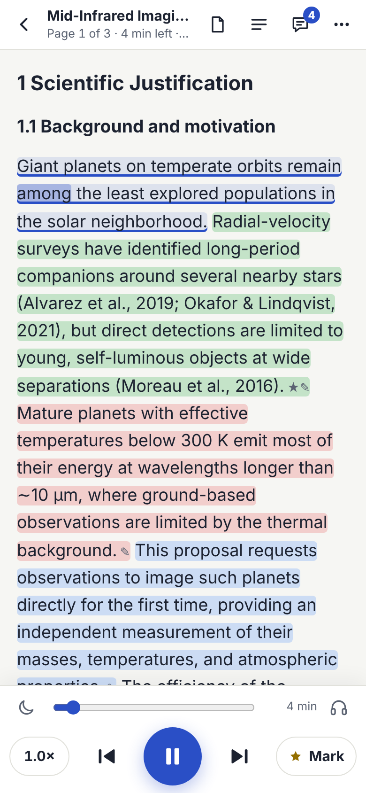
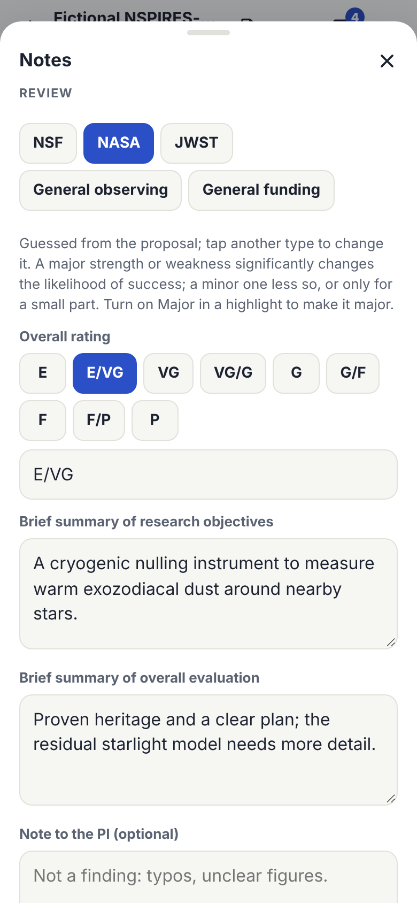

# Proposal Listener

Listen to proposal PDFs like a podcast, mark strengths and weaknesses as you go, and export review notes laid out like the NSF, NASA, or JWST review forms. Everything runs on your device: nothing is uploaded.

**Open the app: https://astrowagner.github.io/pdfreviewer/**

It is made for Safari on iPhone and iPad and also runs in current desktop browsers. There is nothing to install and no account.

Screenshots are from fictional test proposals.

## What It Does

- **Reads proposals aloud** with the text following along word by word. It skips what is not meant to be read, such as axis labels, table cells, citations, and the reference list, and it reads figure captions. You can change all of this in Settings.
- **Marks as you listen.** Press **Mark** to flag the sentence you are hearing, or tap any sentence to highlight it as a strength, weakness, question, or note. Add a note by typing or by dictating with your keyboard's microphone.
- **Follows the review you are writing.** Choose NSF, NASA, JWST, general observing, or general funding. Each sets the criteria your strengths and weaknesses are filed under, the rating scale, and how the export is laid out. The type is guessed from the proposal. See [Review Types](docs/review-types.md).
- **Exports your notes** as a notes report PDF, as the original PDF annotated with your highlights and notes as comments (for Preview or Acrobat), or as text to paste into the review system.
- **Speaks with your device's voices or a natural AI voice.** The natural voice (Kokoro) runs inside the page after a one-time download of 104 MB.
- **Plays like other audio:** with the screen locked or in another app, with play, pause, and next and previous sentence on the lock screen and on AirPods.
- **Keeps your place, highlights, and notes** on your device. **Save state** puts everything in one file that you can restore on another device.

## Privacy, Briefly

- There is no server and no account, and nothing is uploaded. The page can connect only to its own site, to load its own files; its Content Security Policy enforces this, and you can check it yourself.
- PDFs are read inside the page. The natural voice is an AI model that runs on your device. Device voices that send text to a provider (marked "network") are hidden by default.
- Your proposals, highlights, and notes are stored in your browser on your device.

Details: [Privacy and Data](docs/privacy.md). Review programs have their own confidentiality rules; follow those for the proposals you review.

## Quick Start

1. Copy the proposal PDFs to your device. On iPhone, the Files app works well.
2. Open https://astrowagner.github.io/pdfreviewer/. On iPhone, use Safari and bookmark the page.
3. Tap **Add proposal PDFs** and choose one or more PDFs.
4. Press play. Press **Mark** whenever you hear something worth noting, or tap a sentence to highlight it.
5. Open **Notes** (the speech-bubble icon) to check the review type, add your rating and summary, and **Export notes**.

New to it? The library has a **Sample**: a short fictional proposal to try the voices, highlighting, and exports before you load a real one.

## Guide

- [User Guide](docs/user-guide.md): listening, what is read aloud, highlights, notes, exports, saving, and every setting.
- [Review Types](docs/review-types.md): what NSF, NASA, JWST, general observing, and general funding change, with sources.
- [iPhone and iPad](docs/iphone.md): Safari tips, the lock screen and AirPods, the natural voice on a phone, and storage.
- [Privacy and Data](docs/privacy.md): what stays where, and how to check it.
- [Troubleshooting and FAQ](docs/troubleshooting.md)
- [How It Works](docs/how-it-works.md): for the technically curious.
- [What's New](CHANGELOG.md)

## Known Limitations

- **Premium and Enhanced iOS voices do not appear.** Safari offers web pages only the voices built into iOS. Use the natural voice for a better voice.
- **On a phone, the natural voice is made slower than real time** (about 1.3 seconds of work per second of speech on a recent iPhone). Use **Prepare ahead** before you listen, or expect pauses while it catches up.
- **Safari may close the page** during long natural-voice sessions when memory runs short. On iPhone the app restarts the voice engine regularly to reduce this, and if the page is closed while preparing ahead, preparing continues the next time you press play.
- **Scanned PDFs** (images without selectable text) cannot be read aloud.
- **English only:** the natural voice and the text cleanup are for English.

## Reporting a Problem

In the app, open **Settings › Copy diagnostic log**. The log has events and timings but no proposal text or file names. Then open an issue in this repository (the **Issues** tab) and paste it. Issues are public, so never paste proposal text or attach a proposal.

## Repository Contents

- `index.html`: the app, in one file. Its code is readable in the file.
- `kokoro/`: the natural-voice files, downloaded on first use and checked by SHA-256.
- `docs/`: this guide and its screenshots.
- `CHANGELOG.md`: what changed, by date.
- `THIRD_PARTY_NOTICES.md` and `LICENSES/`: the components the app includes, and their licenses.
- `tools/strip_espeak_data.py`: the script that made the English-only phonemizer data.
