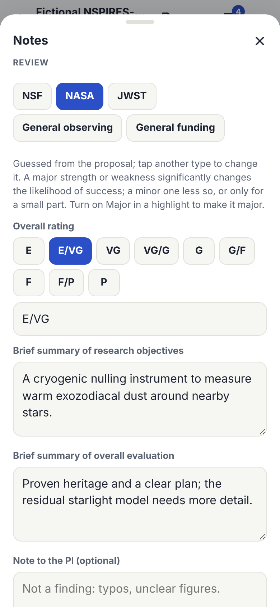
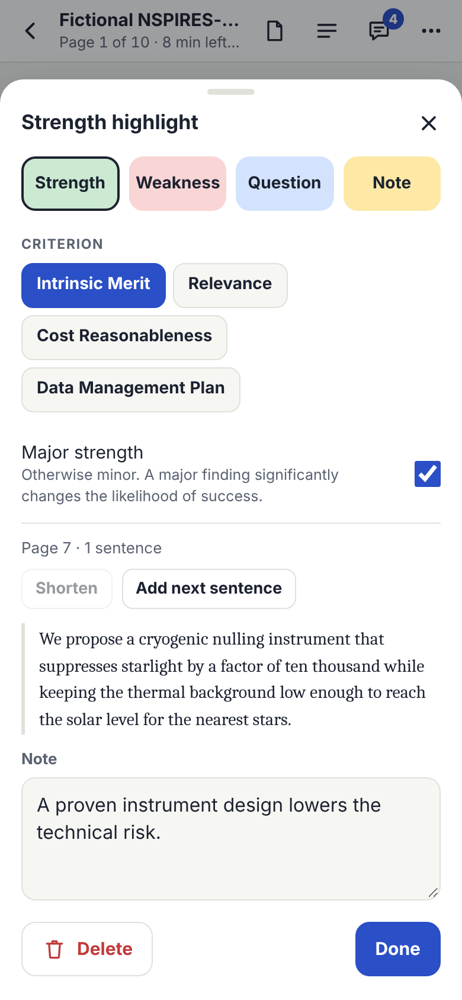
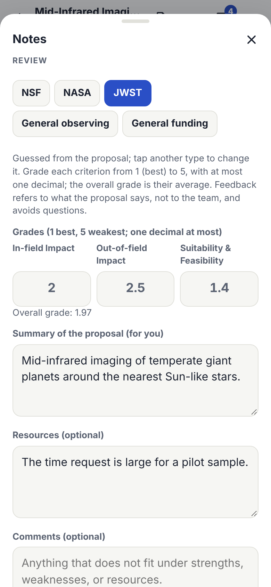

# Review Types

Each proposal has a review type: **NSF**, **NASA**, **JWST**, **General observing**, or **General funding**. The type sets:

- the **criteria** your strengths and weaknesses are filed under,
- the **rating** (a scale to tap, three grades, or text),
- the **fields** in your review (for example NSF's summary statement), and
- the **layout** of your exports: the notes report PDF and **Copy review text** follow the order of the program's form, so you can paste section by section.

Your questions and notes are for you. They come last in the exports, marked "not part of the review".

## Choosing the Type

The type is **guessed from the proposal** when you open it, from the text of its first pages (running headers included):

| The first pages contain | Guessed type |
|---|---|
| An NSPIRES or ROSES identifier (such as NNH25ZDA001N) | NASA |
| Both "Intellectual Merit" and "Broader Impacts" | NSF |
| "JWST" with a cycle number, or JWST mentioned throughout | JWST |
| An observing-time request, a time allocation committee, or a telescope with a cycle, period, or semester | General observing |
| None of these | The type you chose last (General funding at first) |

When the type was guessed, **Notes** says so. **Tap another type to change it**; your choice is kept for that proposal and becomes the default for proposals that give no clue. Changing the type never changes your highlights or notes, only how they are grouped and labeled.

## Criteria: How Highlights Are Filed

When you highlight a strength or weakness, the app files it under a criterion **from the section it is in**. For example, a weakness inside "Broader Impacts" goes under Broader Impacts. A sentence under "Travel" inside "Budget Justification" goes under the budget criterion, because its parent section counts. A neighboring section does not count. Budget form pages count as budget too. Anything else goes under the type's first criterion.

To change it, open the highlight (tap it, then **Edit this … highlight**) and tap another criterion. Notes shows each highlight's criterion, and the annotated PDF's comments name it.

## NSF

- **Criteria:** Intellectual Merit; Broader Impacts (sections whose heading says Broader Impacts); Solicitation-specific criteria (sections about solicitation-specific or additional review criteria).
- **Rating:** E (Excellent), VG (Very Good), G (Good), F (Fair), P (Poor), or two adjacent ratings such as E/VG. Tap one, or type one.
- **Fields:** Summary of the proposal (for you); **Summary statement**.
- **Export order:** rating; summary of the proposal; Intellectual Merit, Broader Impacts, and Solicitation-specific criteria, each with strengths and weaknesses (major first); summary statement; then your questions and notes.

This follows NSF's review form, which asks for Intellectual Merit, Broader Impacts, any solicitation-specific criteria, a summary statement, and one or two ratings, depending on the funding opportunity.

## NASA

- **Criteria:** Intrinsic Merit; Relevance (sections headed Relevance); Cost Reasonableness (budget pages, and sections headed Budget or Cost); Data Management Plan (sections headed Data Management or Open Science).
- **Major and minor:** under Intrinsic Merit, findings are grouped as major strengths, minor strengths, major weaknesses, and minor weaknesses. Turn on **Major** in a highlight to make it major; otherwise it is minor. A major finding significantly changes the likelihood of success; a minor one less so, or affects only a small part of the proposal.
- **Rating (overall):** E, E/VG, VG, VG/G, G, G/F, F, F/P, P. Tap one, or type one. Relevance and cost scales vary by program; write them in your notes if your panel uses them.
- **Fields:** Brief summary of research objectives; Brief summary of overall evaluation; Note to the PI (optional: typos, unclear figures); **Comments to NASA (not shared with the PI)**.
- **Export order:** overall rating; brief summary of research objectives; brief summary of overall evaluation; Intrinsic Merit (major and minor); Relevance; Cost Reasonableness; Data Management Plan; note to the PI; comments to NASA; then your questions and notes.

This follows NASA's example panel evaluation for ROSES.

## JWST

- **Grades:** one for each primary criterion, from 1 (best) to 5, with at most one decimal: **In-field Impact**, **Out-of-field Impact**, and **Suitability & Feasibility**. The app shows their average, which is how STScI combines them. A grade outside 1 to 5 is not kept.
- **Criteria for highlights:** none. Strengths and weaknesses are listed as such, with major ones first.
- **Fields:** Summary of the proposal (for you); **Resources** (optional: the time request, targets, or instruments, only if something is out of the ordinary); **Comments** (optional: anything that does not fit elsewhere).
- **Export order:** grades and their average; summary; strengths; weaknesses; resources; comments; then your questions and notes.
- **Writing feedback:** STScI asks that feedback refer to what the proposal says rather than to the team, and avoid questions. JWST reviews are dual-anonymous.

## General Observing

For other telescope time allocation committees.

- **Criteria:** Scientific merit; Technical feasibility (sections about technical justification, feasibility, observations or the observing strategy, exposures, or instruments); Time and resources requested (sections about the time request or its justification).
- **Rating:** type a grade, such as 1.5 or Excellent, in the committee's own scale.
- **Fields:** Summary of the proposal; Overall assessment.

## General Funding

For other funding proposals.

- **Criteria:** Significance and impact; Approach and methods (sections about methods, the approach, the work or research plan, the timeline, or technical details); Team and resources (sections about personnel, the team, qualifications, facilities, or project management); Budget (budget pages, and sections headed Budget or Cost).
- **Rating:** type a rating, such as Very Good or 2.1.
- **Fields:** Summary of the proposal; Overall assessment.

## Always Check the Program's Own Instructions

Forms change between cycles and solicitations, and some panels add their own criteria or scales. The review types are a convenient layout for your notes, not the official form. Follow the instructions you were given for the review.

## Sources

- NSF: [Merit review](https://www.nsf.gov/bfa/dias/policy/meritreview) and the [Proposal Evaluation System quick-start guide for ad hoc reviews](https://nsf-gov-resources.nsf.gov/files/PES%20Quickstart%20Guide%20Ad%20Hoc%20Reviews%20External_508.pdf) (review sections and one or two ratings).
- NASA: [Example ROSES panel evaluation](https://assets.science.nasa.gov/content/dam/science/cds/researchers/library-and-useful-links/2025/ExamplePanelEvaluation_070825.pdf) (2025: sections, major and minor findings, rating scale and split ratings).
- JWST: [Selection criteria and scoring system](https://jwst-docs.stsci.edu/jwst-opportunities-and-policies/jwst-peer-review-information/reviews-grades-and-comments/selection-criteria-and-scoring-system) and [Proposal feedback comments](https://jwst-docs.stsci.edu/jwst-opportunities-and-policies/jwst-peer-review-information/reviews-grades-and-comments/proposal-feedback-comments) (STScI).
