# User Guide

Proposal Listener reads proposal PDFs aloud with the text following along, lets you highlight and annotate as you listen, and exports your review notes. This guide covers everything in the app. For iPhone-specific advice, see [iPhone and iPad](iphone.md); for what is stored where, see [Privacy and Data](privacy.md).

Open the app: https://astrowagner.github.io/pdfreviewer/

- [Getting Started](#getting-started)
- [Listening](#listening)
- [Voices](#voices)
- [What Is Read Aloud](#what-is-read-aloud)
- [Highlights and Notes](#highlights-and-notes)
- [Your Review and Exports](#your-review-and-exports)
- [Saving and Moving Between Devices](#saving-and-moving-between-devices)
- [Keyboard Shortcuts](#keyboard-shortcuts)
- [Settings Reference](#settings-reference)

## Getting Started

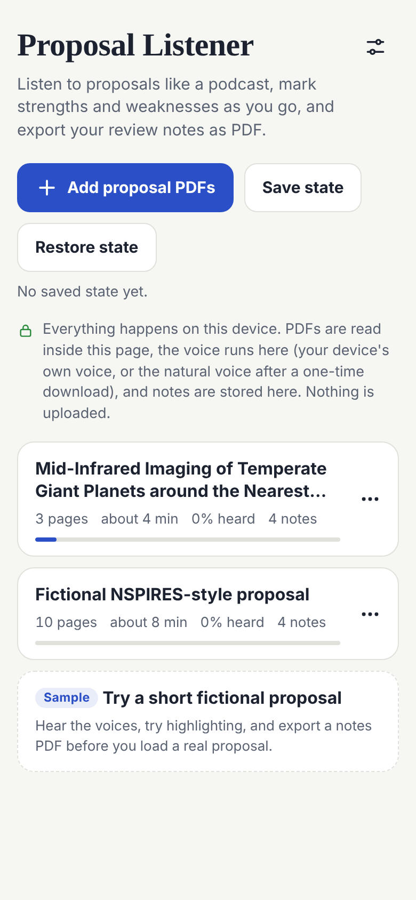

**Add proposals.** Copy the PDFs to your device, then tap **Add proposal PDFs** and choose one or more. On iPhone the picker opens the Files app. A single PDF opens right away; several appear in the library.

**Try the sample first.** The library has a **Sample**, a short fictional proposal. Use it to hear the voices, try highlighting, and export a notes PDF before you load a real proposal.

**The library** lists your proposals, most recently opened first. Each shows its pages, about how long it takes to listen to at your speed, how much you have heard, and how many notes you have. The bar shows where you are.

**Rename or remove a proposal** with its **⋯** button: edit the **Title**, or **Remove from this device**, which deletes the PDF, its highlights, and its notes from this device. Export your notes first if you still need them.

 

## Listening

**Play and pause** with the big button. **Previous** and **next** move one sentence at a time. Drag the bar above the controls to move through the proposal; the time on its right is about how long is left.

**Tap any sentence** to open it. From there you can **Play from here**, highlight it, or **Copy sentence**.

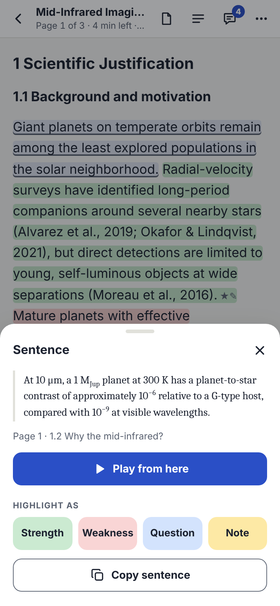

**The text follows the voice.** The sentence being read is underlined, and the current word is shaded. If you scroll away, **Back to the spoken sentence** brings you back. You can turn following off in Settings (**Follow the spoken sentence**).

**Sections and search** (the list icon at the top): search the proposal, or jump to a section or a page. Cover pages and budget pages are folded into a **Cover pages** entry and a **Budget** entry, and each section folds its subsections. The arrow opens a group, tapping a row jumps there, and **Expand all** opens everything. The section you are in opens by itself.

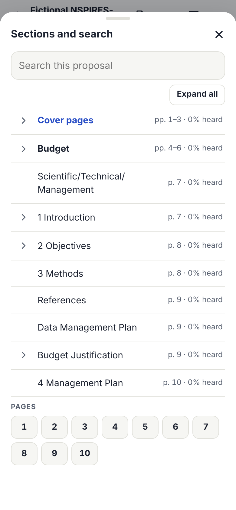

**The original pages** (the page icon at the top) show the PDF as printed, with your highlights and the spoken sentence marked. Use **−** and **+** to zoom, and the same button to return to the text.

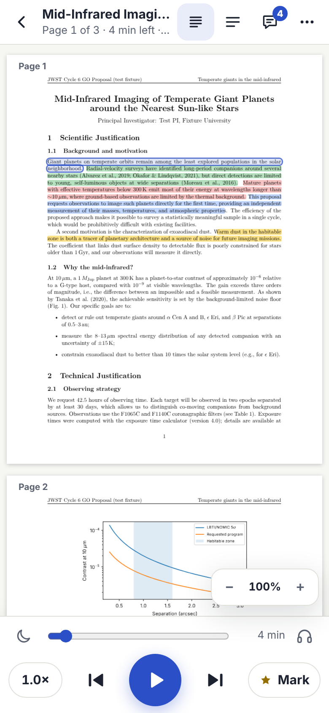

**Hands-free view** (the headphones icon by the bar, or **More › Hands-free view**) shows the current sentence in large type with large controls and a **Mark this sentence** button, for listening while walking or commuting.

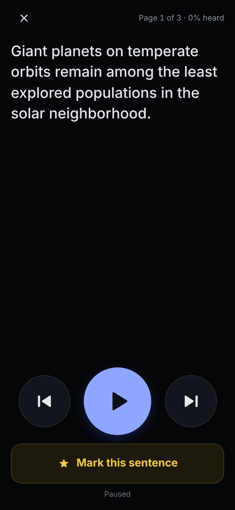

**Sleep timer** (the moon icon): pause after 10 to 60 minutes, or at the end of the section.

**Lock screen and headphones.** Listening goes on with the screen locked or in another app, and the app shows on the lock screen and in Control Center (or in your computer's media controls) like other audio: the proposal's title, the page, and the time left. Play and pause work from there and from headphones; **next** and **previous** go one sentence forward or back; dragging the progress bar jumps to that point in the proposal. On iPhone, taking out your AirPods pauses the reading; see [The Lock Screen, Other Apps, and AirPods](iphone.md#the-lock-screen-other-apps-and-airpods).

**Keep the screen on** (Settings › **Keep the screen on while playing**) keeps the screen from dimming while you listen, so you can follow the text.

## Voices

Open **Voice and speed** with the speed button (for example **1.0×**) at the bottom left.

**Speed:** 0.5× to 3×, with buttons for common speeds. **Sleep timer** is here too.

There are two kinds of voices:

**Device voices** are the voices your device already has.
- **On-device voices only** (on by default) hides voices that send text to the voice provider over the network, such as Chrome's Google voices. Keep it on for confidential proposals.
- **Show all voices** also lists other languages and novelty voices.
- **Test voice** plays a sample; **Pitch** adjusts it.
- On iPhone, Safari lists only the voices built into iOS. Enhanced and Premium voices you download in iOS Settings do not appear; this is an iOS privacy rule, not a setting in the app. Use the natural voice instead.

**Natural (on device)** is Kokoro, an AI voice that runs entirely inside the page, so proposal text never leaves your device.

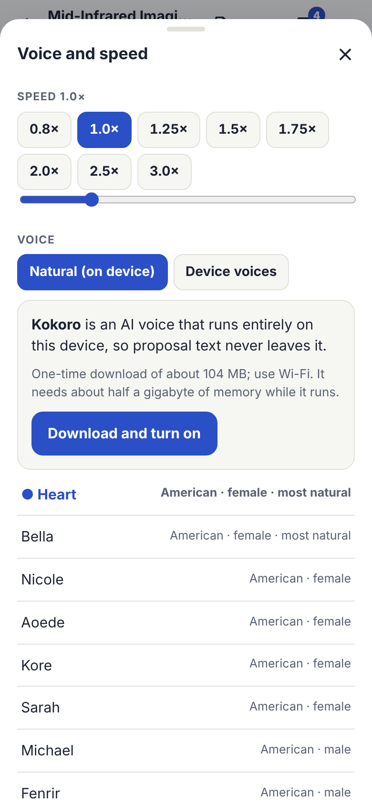
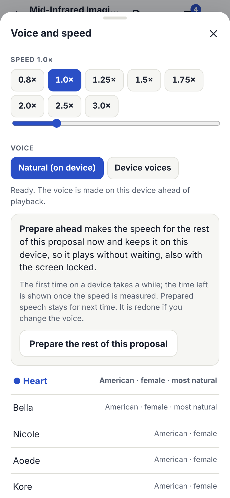

- **Download and turn on** downloads its files once, about 104 MB (use Wi-Fi). They are kept on the device. While it runs it needs about half a gigabyte of memory.
- There are 13 voices, American and British, female and male; Heart and Bella are the most natural.
- The voice speaks at the chosen speed (up to 2×) rather than stretching the audio.
- On a phone the voice is made more slowly than you listen. It prepares speech ahead, and when it falls behind it collects enough speech to then play for a while without stopping, and it tells you how long that takes.
- **Prepare ahead** makes the speech for the rest of the proposal now and keeps it on this device. It then plays without waiting, also with the screen locked and next time you open the proposal. Prepared speech is redone if you change the voice. Preparing goes on if you switch to **Device voices** and listen meanwhile, but on a phone it will not catch up with where the device voice is reading.
- **Use two processor cores when needed** (not on Android) makes the voice faster when it falls behind, but uses about 400 MB more memory. On iPhone it is off by default, because Safari may close pages that use that much memory.
- After the page reloads, the natural voice stays on: it loads from this device in a second or two when you press play.
- On a device where the natural voice has not been downloaded (for example after restoring a state from another device), play uses the device voice and says so. Nothing is downloaded until you choose **Download and turn on**.

## What Is Read Aloud

The app sorts every block of text in the PDF into body text, headings, captions, footnotes, figure or table text, and the reference list, and reads it with cleanup for listening. In Settings › **Reading aloud**:

| Setting | Default | What it does |
|---|---|---|
| Skip citations | On | Leaves out "(Author et al. 2020)" and "[12]" while reading. |
| Skip the reference list | On | |
| Skip figure and table text | On | Axis labels, tick numbers, legends, table cells. |
| Read figure and table captions | On | |
| Skip footnotes | Off | |
| Skip web addresses | On | Says "link" instead. |
| Expand abbreviations and units | On | "e.g." becomes "for example"; "10 μm" becomes "10 microns"; "β Pic" becomes "beta Pic"; "10⁻⁶" becomes "10 to the minus 6". |
| Pronunciations | Empty | One per line, written as `text = how to say it`, for example `LBTI = L B T I`. |

Skipped text stays visible, dimmed. When you tap a skipped sentence, its panel says so. Form rows on cover pages (such as "Proposal Number: …"), questions, sentences, list items, and e-mail and web addresses are never treated as figure or table text, so they are read.

## Highlights and Notes

There are four kinds of highlight, each with its own color: **Strength**, **Weakness**, **Question**, and **Note**. Strengths and weaknesses go into your review; questions and notes are for you.

Ways to highlight:
- **Mark** (bottom right, or **Mark this sentence** in hands-free view) marks the sentence being read as a Note without stopping. Tap **Add note** in the message to write one.
- **Tap a sentence** and choose a kind under **Highlight as**.
- **Select text** across several sentences, then choose a kind in the bar that appears.

**Edit a highlight** by tapping it and choosing **Edit this … highlight**, or with **Edit** in Notes:

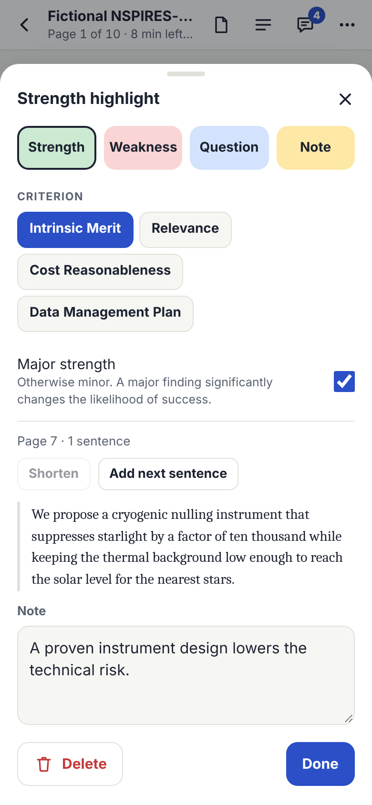

- Change its kind.
- **Criterion:** strengths and weaknesses are filed under one of the review's criteria, such as Broader Impacts for NSF or Cost Reasonableness for NASA. The app chooses from the section the highlight is in; one tap changes it. See [Review Types](review-types.md).
- **Major strength** or **Major weakness:** major findings are listed first. For NASA reviews, the others count as minor.
- **Shorten** or **Add next sentence** to change how much it covers.
- **Note:** what it means for your review. Your keyboard's microphone button can dictate.
- **Delete** (with **Undo** in the message that follows).

**Notes** (the speech-bubble icon at the top, with a count) lists every highlight with its note, in the order of the proposal. Filter by kind; **Show** jumps to it, **Play** plays from it, and **Edit** opens it.

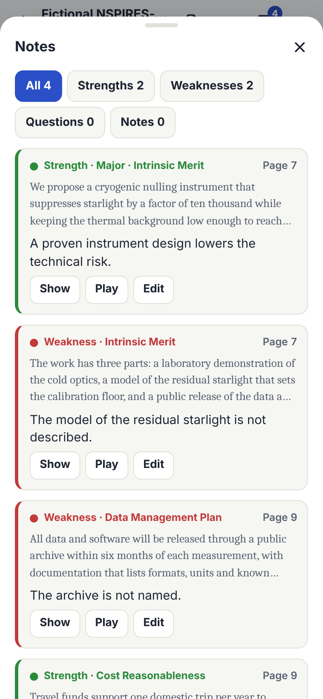

## Your Review and Exports

At the bottom of **Notes** is your **Review**:

- **Review type:** NSF, NASA, JWST, General observing, or General funding. It is guessed from the proposal (the message says so); tap another to change it. The type you choose is also used for proposals that give no clue. See [Review Types](review-types.md) for what each one changes.
- **Rating:** for NSF and NASA, tap a rating from E (Excellent) to P (Poor), including split ratings such as E/VG, or type one. For JWST, enter a grade from 1 (best) to 5 for each of the three criteria, and the app shows their average. For the general types, type a rating or grade.
- **Fields** for that program's form, such as NSF's **Summary statement**, or NASA's **Note to the PI** and **Comments to NASA (not shared with the PI)**.

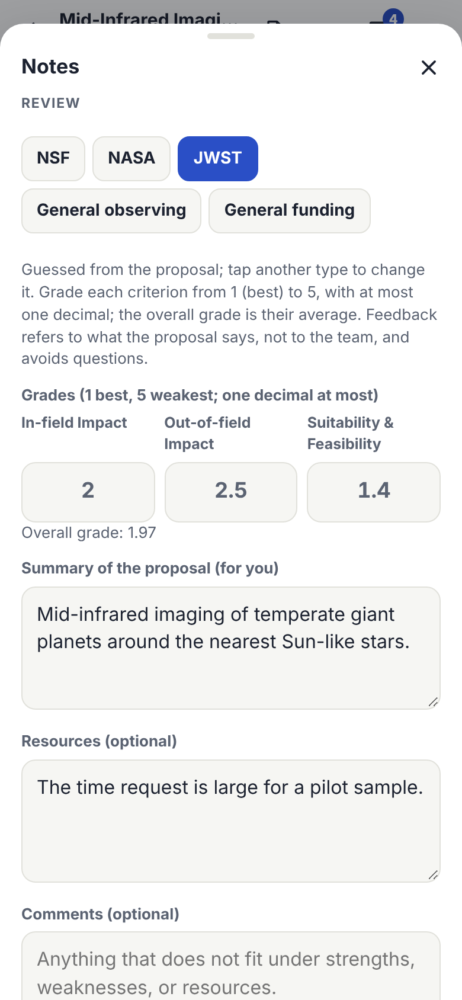

**Export notes** (in Notes, or **More › Export notes**):

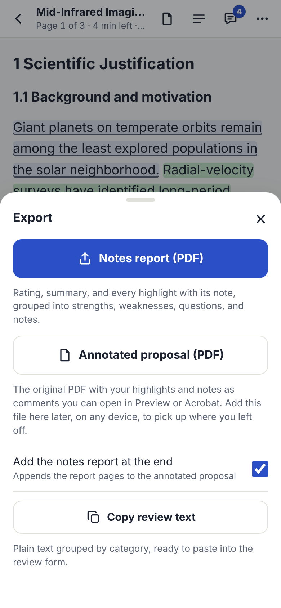

- **Notes report (PDF):** your rating and review, with every strength and weakness and its note, laid out in the order of the program's form, followed by your own questions and notes. Each page is marked "Confidential: proposal review notes".
- **Annotated proposal (PDF):** the original PDF with your highlights, and your notes as comments that open in Preview or Acrobat. Each comment names its kind, and its criterion where the review type has criteria. **Add the notes report at the end** appends the report pages. Adding this file to the app later, on any device, brings back your highlights, notes, and review.
- **Copy review text:** plain text in the same order, ready to paste into the review system section by section.

**Author name on PDF comments** (Settings › Notes) is "Reviewer" by default, because reviews are usually anonymous.

**Where files go:** your browser saves them where downloads go. On iPhone, that is Files › Downloads, which is in iCloud Drive unless you choose **On My iPhone** in iOS Settings › Apps › Safari › Downloads.

## Saving and Moving Between Devices

**Everything is kept on this device as you go:** the PDFs, highlights, notes, your review, and your place. Notes are stored on every change. Your place is stored about every sentence, when you pause, and when you leave the page.

**Reopen where I left off** (on by default): when the app starts, the browser reloads it, or you restore a state, it opens the last proposal paused at the word where you stopped. Going back to the library first means the next start shows the library.

**Save state** (in the library, in Settings, or under **More**) saves one PDF file with every proposal, its highlights, notes, review, and your place, plus your settings. Its cover page lists what is inside. **Restore state** brings it all back, on this device or another:

- Restoring replaces the proposals in the file, merges their notes with any you made since, keeps other proposals, and reopens the one that was open.
- Each proposal's PDF is checked by size and SHA-256. A damaged one is reported and left out; the rest is restored.
- The file does not contain the natural voice download or prepared speech, and two settings stay as each device has them: the voice worker limit and **Save state automatically**.
- The state file contains your proposal PDFs, so keep it private.

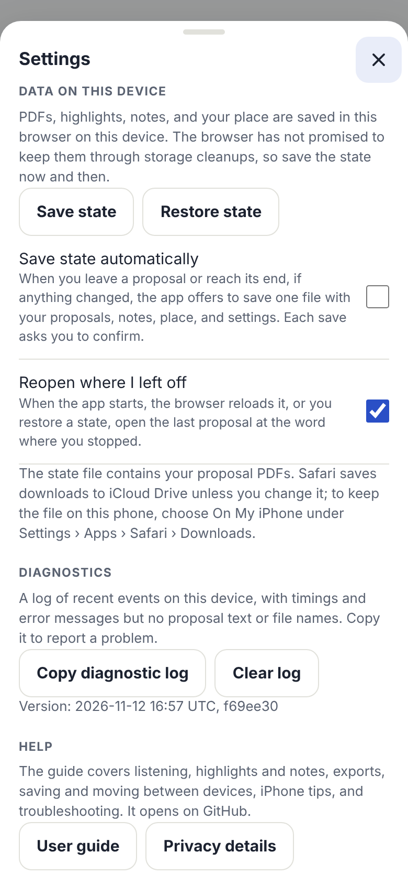

**Save state automatically** (Settings): when you leave a proposal or reach its end, if anything changed, the app offers to save the state file. Each save asks you to confirm. It is on by default only where the browser erases the app's data when it quits.

**Save a notes PDF automatically** (Settings, off by default): when you leave a proposal or reach its end, if your notes changed since the last save, the notes report is saved. Each save asks you to confirm.

**Another way to move one proposal:** export the **Annotated proposal (PDF)** and add it on the other device.

**Why save at all?** Browsers can clear a site's data: Safari, for example, removes a site's stored data after 7 days of Safari use without a visit to it, and storage cleanups can remove it too. At startup the app asks the browser to keep its data; Settings › **Data on this device** shows whether the browser agreed.

## Keyboard Shortcuts

On a computer: **Space** play or pause, **←** and **→** previous or next sentence, **M** mark, **N** notes, **/** search, **+** and **−** speed.

## Settings Reference

Open Settings from the sliders icon in the library or **More › Settings**.

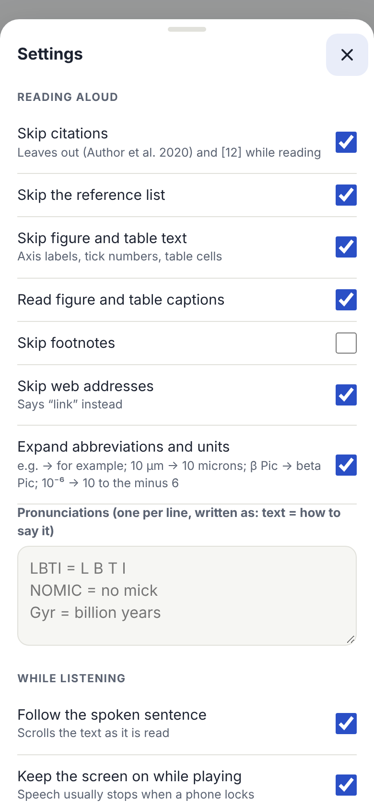

| Section | Setting | Default |
|---|---|---|
| Reading aloud | Skip citations; Skip the reference list; Skip figure and table text; Read figure and table captions; Skip web addresses; Expand abbreviations and units | On |
| Reading aloud | Skip footnotes | Off |
| Reading aloud | Pronunciations | Empty |
| While listening | Follow the spoken sentence; Keep the screen on while playing | On |
| Text | Text size | 18 px |
| Text | Serif typeface | Off |
| Text | Theme: Match device, Light, Sepia, or Dark | Match device |
| Notes | Save a notes PDF automatically | Off |
| Notes | Author name on PDF comments | Reviewer |
| Data on this device | Save state, Restore state | |
| Data on this device | Save state automatically | Off, except where the browser erases the app's data when it quits |
| Data on this device | Reopen where I left off | On |
| Diagnostics | Copy diagnostic log; Clear log; the app's version | |
| Help | User guide; Privacy details | |

Voice settings (speed, voice, pitch, **On-device voices only** (on), **Show all voices** (off), the natural voice, and the sleep timer) are under **Voice and speed**.
